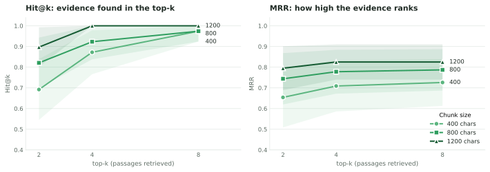
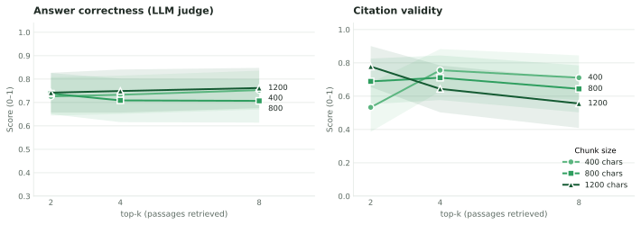

<div align="center">

# Web RAG Evaluator

**Ask questions about any public webpage, get answers with checkable citations,<br>and measure how good those answers are.**

[](https://web-rag-evaluator-frontend.onrender.com)
[](experiments/REPORT.md)
[](LICENSE)


<sub>The live demo runs on free hosting. If it has been idle, the first load takes up to a minute while the server wakes up.</sub>

<br>

## ◆ Tech stack


<br>


-1f2328?style=flat-square)


<br>

## ◆ Features

| | |
|:---:|:---|
| 🌐 | **Load any public webpage:** main content is extracted, chunked and embedded |
| 💬 | **Grounded answers:** each answer cites its passages as `[S1]`, and you can click a citation to see the source |
| 📊 | **Built-in evaluation:** retrieval relevance, groundedness, correctness and citation validity |
| 🧪 | **Experiment framework:** compare chunk size and top-k with Hit@k, MRR and 95% confidence intervals |
| 💸 | **Runs free:** Ollama locally, or Google Gemini's free tier when hosted. OpenAI is optional |

<br>

## ◆ How it works

```text
Webpage ─▶ Extract main text ─▶ Chunk ─▶ Embed ─▶ ChromaDB
                                                     │
Question ─▶ Embed ─▶ Retrieve top-k chunks ◀─────────┘
                           │
                           ▼
           LLM answer with [S#] citations ─▶ Citation check ─▶ LLM judge scores
```

<br>

## ◆ Evaluation

| Metric | Measures | Scored by |
|:---|:---|:---:|
| Retrieval relevance | Are the retrieved passages relevant to the question? | LLM judge |
| Groundedness | Is the answer supported by those passages? | LLM judge |
| Answer correctness | Does it match the expected answer? | LLM judge |
| Citation validity | Share of written citations that point to a real passage | Code |

The overall score is the mean of the four (0–1); a case **passes at ≥ 0.70**.

<br>

## ◆ Results

**45 questions · 3 webpages · 9 settings · 405 judged answers · all run locally for free**





| Finding | Evidence |
|:---|:---|
| More retrieved passages always helped retrieval | Hit@k reaches ≥ 0.97 at top-k 8 for every chunk size |
| Larger chunks find and rank the evidence better | At top-k 2: Hit@k 0.69 → 0.90 and MRR 0.65 → 0.80 (400 → 1200 chars) |
| Small chunks struggle most on single facts | At top-k 4, facts: 0.80 (400) vs 1.00 (1200); multi-part questions: 1.00 everywhere |
| Better retrieval did **not** raise answer quality on average | Answer correctness stays 0.71–0.76 in all 9 settings, so the 3B generator is the bottleneck |
| More context made citations **worse** | Citation validity at 1200 chars: 0.78 (k 2) → 0.56 (k 8), as uncited answers doubled |
| The model mostly refused unanswerable questions | 47 of 54 correct refusals; the misses leaked outside knowledge ("Python 3.8") |
| The LLM judge itself is biased | It scored correct refusals only 0.15 for correctness |
| Best setting tested | **1200 chars × top-k 2:** overall 0.75, citations 0.78, 67% pass rate |

**[Read the full report →](experiments/REPORT.md)**

<br>

## ◆ Quick start (free, local)

**Requirements:** Python 3.10+, Node.js 20+ and [Ollama](https://ollama.com)

</div>

```bash
git clone https://github.com/Vijaypn87/Web-RAG-Evaluator.git
cd Web-RAG-Evaluator

python -m venv .venv
.venv/Scripts/python -m pip install -r requirements.txt   # macOS/Linux: .venv/bin/python
cp .env.example .env                                     # already set up for free mode

ollama pull llama3.2
ollama pull nomic-embed-text
```

```bash
.venv/Scripts/python -m uvicorn backend.main:app --reload --port 8000   # terminal 1
cd frontend && npm install && npm run dev                               # terminal 2
```

<div align="center">

Open **http://localhost:5173**

<br>

<details>
<summary><b>Configuration</b></summary>
<br>

All settings live in `.env`; see [`.env.example`](.env.example) for the full list.

| Setting | Options | Default |
|:---|:---|:---|
| `LLM_PROVIDER` | `ollama` · `gemini` · `openai` | `openai` (the example sets `ollama`) |
| `PAGE_FETCHER` | `local` (Trafilatura) · `contextdev` | `local` when no Context.dev key is set |
| `GEMINI_API_KEY` | Free key from [Google AI Studio](https://aistudio.google.com/apikey) | – |
| `RATE_LIMIT_PER_HOUR` / `DAILY_LIMIT` | Request limits for a public demo (0 = off) | `30` / `500` |

</details>

<details>
<summary><b>Deploy for free (Render + Gemini)</b></summary>
<br>

On the Render **backend** service set `LLM_PROVIDER=gemini`, `PAGE_FETCHER=local`,<br>
`GEMINI_API_KEY=<your key>` and `FRONTEND_ORIGIN=<frontend URL>`.<br>
On the **frontend** static site set `VITE_API_URL=<backend URL>`.<br>
Then check `<backend URL>/api/info`: it should report `gemini` and `local`.

</details>

<details>
<summary><b>Run the experiment yourself</b></summary>
<br>

```bash
python -m experiments.run_experiment --dataset experiments/datasets/rag_eval_45.json --retrieval-only
```

Add `--out <folder> --resume` to the full run so an interruption picks up where it stopped.<br>
See the [experiments guide](experiments/README.md) for writing your own datasets.

</details>

<br>

## ◆ Project structure

| Folder | Contents |
|:---|:---|
| `backend/` | FastAPI app, RAG pipeline, model providers, request limits |
| `frontend/` | React + TypeScript single-page app |
| `experiments/` | Grid runner, metrics, datasets, results and report |
| `tests/` | pytest suite (no network calls): `python -m pytest` |

<br>

## ◆ License

[MIT](LICENSE) © 2026 Vijay PN

</div>
