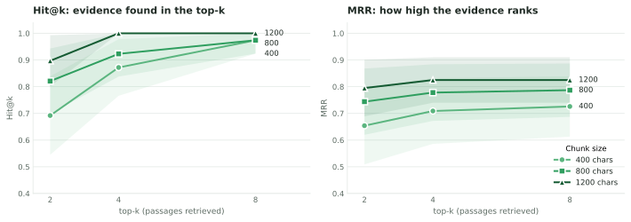
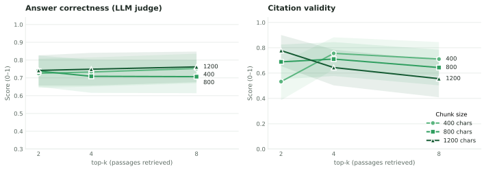

# How chunk size and top-k affect a small RAG system

*Web RAG Evaluator: experiment report*

## 1. Question

A retrieval-augmented generation (RAG) system splits a document into chunks, retrieves the *k* chunks most similar to a question, and asks a language model to answer from them. Two settings are chosen almost by habit: **how big each chunk is** and **how many chunks to retrieve (top-k)**.

This experiment asks: **how do chunk size and top-k change (a) whether the right passage is retrieved and (b) the quality of the final answer**, and is there a setting that does well on both?

## 2. Setup

| | |
|---|---|
| **Pages** | 3 public pages: Wikipedia *Retrieval-augmented generation* and *Vector database* (encyclopedia style), and the Python tutorial chapter *Data Structures* (technical documentation) |
| **Questions** | 45: 25 single **facts**, 14 **multi-part** (need several details), 6 **unanswerable** (the page does not contain the answer) |
| **Ground truth** | For every answerable question, an expected answer and a short **evidence phrase** copied from the page. All 39 phrases were checked automatically against the extracted page text. |
| **Grid** | chunk size 400 / 800 / 1200 characters (overlap 12.5%) × top-k 2 / 4 / 8 = 9 configurations |
| **Models** | `nomic-embed-text` embeddings, `llama3.2` (3B) for answering *and* judging, all run locally with Ollama |
| **Runs** | 405 answer-and-judge runs plus a separate retrieval-only pass, at temperature 0 |

The question set was drafted with AI assistance and reviewed by the author. Each page was fetched once and cached, so every configuration saw identical text.

### Metrics

- **Hit@k:** 1 if any of the top-k chunks contains the evidence phrase, otherwise 0. Deterministic; needs no language model.
- **MRR:** 1 / (rank of the first chunk containing the evidence), 0 if it is not in the top-k.
- **Retrieval relevance, groundedness, answer correctness:** 0–1 scores from an LLM judge.
- **Citation validity:** share of the answer's `[S#]` citations that point to a passage actually supplied. A correctly worded "not enough information" reply with no citations scores 1.
- **Overall:** mean of the last four; a case **passes at ≥ 0.70**.

Values below are means with a 95% normal-approximation confidence half-width (±). Hit@k and MRR are computed over the 39 answerable questions.

## 3. Results: retrieval



| Chunk size | top-k | Context (chars) | Hit@k | MRR |
|---:|---:|---:|---:|---:|
| 400 | 2 | ~800 | 0.69 ± 0.15 | 0.65 ± 0.14 |
| 400 | 4 | ~1,600 | 0.87 ± 0.11 | 0.71 ± 0.12 |
| 400 | 8 | ~3,200 | 0.97 ± 0.05 | 0.73 ± 0.11 |
| 800 | 2 | ~1,600 | 0.82 ± 0.12 | 0.74 ± 0.12 |
| 800 | 4 | ~3,200 | 0.92 ± 0.09 | 0.78 ± 0.11 |
| 800 | 8 | ~6,400 | 0.97 ± 0.05 | 0.79 ± 0.10 |
| 1200 | 2 | ~2,400 | 0.90 ± 0.10 | 0.80 ± 0.11 |
| 1200 | 4 | ~4,800 | **1.00 ± 0.00** | **0.82 ± 0.09** |
| 1200 | 8 | ~9,600 | 1.00 ± 0.00 | 0.82 ± 0.09 |

**Observations**

1. **More passages always helped retrieval.** Hit@k rises with k for every chunk size; with k = 8 all sizes find the evidence for at least 97% of questions.
2. **Larger chunks found and ranked the evidence better.** At k = 2, Hit@k climbs from 0.69 (400) to 0.90 (1200), and MRR from 0.65 to 0.80.
3. **Part of that gain is simply more text.** A 1200-character chunk holds three times the text of a 400-character one. At the *same* context budget of ~1,600 characters, 800 × 2 and 400 × 4 reach a similar Hit@k (0.82 vs 0.87), but the larger chunks rank the evidence higher (MRR 0.74 vs 0.71). Small chunks split sentences away from the words that make them match the question.
4. **Single facts are the hard case for small chunks.** At k = 4, multi-part questions found their evidence 100% of the time at every chunk size, while facts reached 0.80 (400), 0.88 (800) and 1.00 (1200).

## 4. Results: answers



| Chunk size | top-k | Correct | Grounded | Citations | Overall | Pass rate |
|---:|---:|---:|---:|---:|---:|---:|
| 400 | 2 | 0.73 ± 0.08 | 0.80 ± 0.07 | 0.53 ± 0.15 | 0.70 ± 0.05 | 40% |
| 400 | 4 | 0.73 ± 0.08 | 0.80 ± 0.08 | 0.76 ± 0.13 | 0.75 ± 0.07 | 64% |
| 400 | 8 | 0.75 ± 0.08 | 0.78 ± 0.09 | 0.71 ± 0.13 | 0.73 ± 0.06 | 60% |
| 800 | 2 | 0.74 ± 0.09 | 0.81 ± 0.08 | 0.69 ± 0.14 | 0.74 ± 0.06 | 56% |
| 800 | 4 | 0.71 ± 0.09 | 0.79 ± 0.09 | 0.71 ± 0.13 | 0.73 ± 0.07 | 56% |
| 800 | 8 | 0.71 ± 0.09 | 0.78 ± 0.09 | 0.64 ± 0.14 | 0.71 ± 0.07 | 53% |
| 1200 | 2 | 0.74 ± 0.09 | 0.80 ± 0.08 | **0.78 ± 0.12** | **0.75 ± 0.06** | **67%** |
| 1200 | 4 | 0.75 ± 0.09 | 0.78 ± 0.09 | 0.64 ± 0.14 | 0.72 ± 0.07 | 58% |
| 1200 | 8 | 0.76 ± 0.09 | 0.80 ± 0.08 | 0.56 ± 0.15 | 0.72 ± 0.06 | 51% |

All 405 runs completed without errors; each took about 10–12 s on a laptop GPU.

**Observations**

5. **Better retrieval did not translate into better answers on average.** Answer correctness stays between 0.71 and 0.76 in every setting, with overlapping intervals, even though Hit@k ranges from 0.69 to 1.00. Once the evidence is usually present, the bottleneck moves to the 3B generator.
6. **Retrieval still matters per question.** When the evidence *was* retrieved, answers scored 0.84 correctness and passed 65% of the time; when it was not, 0.67 and 48%.
7. **More context made citations worse.** With 1200-character chunks, citation validity falls from 0.78 (k = 2) to 0.56 (k = 8); 800-character chunks show the same trend. The main cause is answers with **no citations at all**: 10 of 39 answerable questions at 1200 × 2, but 20 of 39 at 1200 × 8. The small model drops the `[S#]` format when the prompt gets long.
8. **More context reduced false refusals.** The model wrongly said "not enough information" on 4 of 39 answerable questions at 400 × 2, and on none at 1200 × 4 and 1200 × 8.
9. **Refusals mostly worked, with one telling exception.** The model correctly refused 47 of 54 unanswerable cases. All 7 misses were one question, *"In which Python version was the walrus operator introduced?"*, which it answered "Python 3.8" in 6 of 9 settings. That is true, but it is **not on the page**: the model used its own knowledge despite the instructions. Grounding prompts alone do not stop knowledge leakage.
10. **The LLM judge penalises correct refusals.** Those 47 correct refusals match the expected answer word for word, yet the judge scored their correctness at only **0.15** (and retrieval relevance 0.20), so just 5 of 47 "passed". The overall score and pass rate therefore under-rate a system that refuses correctly. This is a flaw in using a small LLM as judge, not in the RAG system.

### Recommended setting

**1200-character chunks with top-k = 2** had the best overall score (0.75), citation validity (0.78) and pass rate (67%), with Hit@k 0.90, while sending the model only about 2,400 characters. **400 × 4** was a close second (0.75, 64%). The app's current default, 800 × 4, sits in the middle (0.73, 56%). The differences in overall score are within the confidence intervals, so this is a reasonable choice rather than a proven winner.

### Failure examples

| Case | Setting | What happened |
|---|---|---|
| *What exception does list.remove() raise…?* | 800 × 8 | Evidence retrieved, but the answer was only `[S4]`: a citation with no text |
| *What should you use to implement a queue?* | 800 × 4 | Same failure: the answer was just `[S2]` |
| *Walrus operator Python version* (unanswerable) | 6 of 9 settings | Answered "Python 3.8" from the model's own knowledge |
| *What exception does list.remove() raise…?* | 1200 × 2 | Evidence retrieved, but the model refused ("not enough information") |

## 4b. Conclusions

- **For retrieval, bigger chunks and more passages help.** For this mix of pages, 1200-character chunks found the evidence for every question at k ≥ 4.
- **For answers, the generator is the bottleneck.** A 3B model's correctness barely moved across settings, and long contexts hurt its citation discipline. A larger model is the obvious next step.
- **Measure the evaluator too.** The LLM judge mis-scored correct refusals, and the metrics that do not depend on it (Hit@k, MRR and citation validity) told the clearest story. Any RAG evaluation should check its judge against cases with a known answer.

## 5. Limitations

- **Small dataset.** 45 questions over 3 pages; most confidence intervals overlap, so differences between neighbouring settings are suggestive, not conclusive.
- **A 3B model judges its own answers.** The same small model answers and scores, so judge scores are noisy and may be biased toward its own phrasing. It also mis-scores correct refusals (§4, point 10). Hit@k, MRR and citation validity do not depend on the judge.
- **Evidence matching is exact text.** A chunk that paraphrases or splits the evidence phrase counts as a miss, and multi-part questions are checked against one phrase only, which likely flatters them.
- **Bigger chunks contain more text.** Hit@k naturally favours them; the equal-context comparison in §3 only partly controls for this.
- **One run per configuration** at temperature 0; repeats were not averaged.

## 6. Reproduce

```bash
python -m experiments.run_experiment --dataset experiments/datasets/rag_eval_45.json --retrieval-only
python -m experiments.run_experiment --dataset experiments/datasets/rag_eval_45.json --out experiments/results/rag_eval_45-full --resume
python -m experiments.make_figures --retrieval experiments/results/rag_eval_45-retrieval --full experiments/results/rag_eval_45-full
```

Raw per-question results (including every generated answer) are in `experiments/results/rag_eval_45-*/cases.csv`, and the exact models and settings in each folder's `config.json`.
